<a id="top"></a>

<div align="center">
  
</div>

<h1 align="center">kairos</h1>

<p align="center"><strong>OpenCode con el harness de <a href="https://github.com/Gentleman-Programming/gentle-shell">gentle-shell</a> portado a su base.</strong></p>

<p align="center">El flujo «el Gentleman» sobre tu terminal: ODD con documento de feature, subagentes enfocados, revisión por riesgo, juicio adversarial y verificación independiente — con memoria persistente, guardas de seguridad y temas, logo y sonidos propios.</p>

<p align="center">
  <a href="https://github.com/runer0101/kairos/actions/workflows/ci.yml"></a>
  <a href="LICENSE"></a>
  <a href="https://nodejs.org"></a>
  <a href="https://pnpm.io"></a>
  <a href="#requisitos"></a>
  <a href="https://github.com/anomalyco/opencode"></a>
  <a href="https://github.com/Gentleman-Programming/gentle-shell"></a>
</p>

<p align="center">
  <strong>
    <a href="#instalación-rápida">Instalación</a>
    &nbsp;·&nbsp;
    <a href="#comandos">Comandos</a>
    &nbsp;·&nbsp;
    <a href="#temas">Temas</a>
    &nbsp;·&nbsp;
    <a href="#documentación">Documentación</a>
    &nbsp;·&nbsp;
    <a href="SECURITY.md">Seguridad</a>
  </strong>
</p>

<br>

<p align="center">Dos mundos en uno: la potencia nativa de OpenCode — LSP, formateadores, snapshots, MCP y plugins — y las herramientas de gentle-shell — agentes, skills, comandos, ODD y guardas — sin renunciar a ninguna.</p>

<p align="center">Pensado para <strong>Linux</strong>, en especial <strong>Arch Linux</strong>, donde se desarrolla y prueba a diario; funciona en cualquier distribución con glibc.</p>

> Proyecto en desarrollo activo: cada push pasa la suite completa, `shellcheck` y un escaneo de privacidad en CI.

<a id="stack"></a>

## 🧱 Stack

Versiones con las que se desarrolla y prueba kairos. `gentle-shell` es opcional: sin él, kairos abre con la última copia sincronizada.

| Proyecto | Versión | Rol |
|---|---|---|
| [OpenCode](https://github.com/anomalyco/opencode) | **1.18.35** | Host: TUI, LSP, MCP, permisos y plugins |
| [gentle-shell](https://github.com/Gentleman-Programming/gentle-shell) | **4.3.0** | Harness fuente: ODD, agentes, guardas y skills |
| [gentle-pi](https://github.com/Gentleman-Programming/gentle-shell) | 4.3.0 | Paquete de gentle-shell que kairos sincroniza |
| [Pi](https://github.com/earendil-works/pi) | 1.2.0 | Runtime que acompaña a gentle-shell |
| [gentle-ai](https://github.com/Gentleman-Programming/gentle-ai) | 4.2.0 | Runtime fijado por gentle-shell 4.3.0 |
| [Engram](https://github.com/Gentleman-Programming/engram) | 3.4.0 | Memoria persistente vía MCP |

<a id="construido-sobre"></a>

## 🙌 Construido sobre

Kairos no existiría sin los dos proyectos en los que se inspira, y el crédito va por delante:

| Proyecto | Qué aporta a kairos |
|---|---|
| [**OpenCode**](https://github.com/anomalyco/opencode) | El host: TUI, LSP, MCP, permisos, plugins y el binario que kairos parchea para el panel izquierdo |
| [**gentle-shell**](https://github.com/Gentleman-Programming/gentle-shell) | La inspiración y el harness que kairos porta: ODD, agentes, guardas, skills e identidad visual |

Gracias también a [Ponytail](https://github.com/DietrichGebert) por la capa de economía de implementación, y a los servidores MCP de memoria y documentación por el contexto persistente.

<a id="qué-incluye"></a>

## 🧩 Qué incluye

Todo lo que trae el port, en una lista:

- **Perfiles de agente** (se cambian con `Tab`): `kairos-auto` (sin preguntas, el de arranque) y `kairos-control` (normal). Los agentes `build` y `plan` de OpenCode quedan desactivados para no confundir el selector.
- **Modos de permiso**: automático por defecto con el perfil `kairos-auto`; normal con `kairos-control`. La guarda de comandos destructivos siempre está activa.
- **Clasificador de auto-aprobación**: aprueba lo seguro y dentro del pedido vivo en el perfil normal, y veta lo peligroso o fuera de alcance en `kairos-auto`; es consejo contextual y cualquier fallo deja la decisión como está (ver *Modos de permiso*).
- **Rutas sensibles protegidas**: credenciales (`~/.ssh`, `~/.gnupg`, `~/.aws`, claves, `auth.json`) bloqueadas en todos los perfiles; `.env`/`.pem` piden confirmación en el perfil normal (ver `SECURITY.md`).
- **Flujo ODD**: `/odd-task <nombre>` crea un documento de feature en el proyecto, con checklist y criterios observables.
- **Revisión** (`/review`), **juicio adversarial** (`/judge`) y **verificación** (`/verify`), con los subagentes de gentle-shell.
- **Ponytail**: economía de implementación (YAGNI, reutilización, `shortcut:`) integrada en el prompt común de los dos perfiles, con `/ponytail`, `/ponytail-review` y `/ponytail-debt` on-demand.
- **Memoria** persistente mediante el servidor MCP `engram`, y documentación de librerías mediante `context7`.
- **DeepSeek v4.1 Flash por defecto** (`opencode-go/deepseek-v4.1-flash`; requiere suscripción OpenCode Go). Si tienes Ollama, LM Studio, llama.cpp o vLLM activos, sus modelos aparecen automáticamente.
- **Calidad de código**: servidores LSP, formateadores y `snapshot` para deshacer cambios.
- **Identidad visual**: 4 temas, logo que sigue al tema activo, sonidos opt-in y HUD con la tarea ODD junto al prompt y en la sidebar.
- **Vista unificada** (`alt+g` o `/agentes`): sesión, subagentes vivos, catálogo de agentes y la tarea ODD a la izquierda; el hilo de la sesión o del subagente (o la ficha del agente) a la derecha, como el overlay de gentle-shell.
- **Panel de gentle-shell a la izquierda** (opcional): binario propio de OpenCode 1.18.35 con un parche mínimo que abre un panel izquierdo — agentes, todos y estado, lo que muestra gentle-shell — junto a la conversación de OpenCode; la sidebar de OpenCode queda a la derecha como siempre. Sin el binario propio, todo funciona igual.
- **Sincronización** con la versión instalada de gentle-shell.

<p align="right"><a href="#top">Volver arriba ↑</a></p>

<a id="requisitos"></a>

## 📋 Requisitos

Linux con glibc; el instalador resuelve el resto.

| Componente | Versión | Cómo se obtiene |
|---|---|---|
| Linux (x86_64 o arm64, glibc) | — | Cualquier distribución con glibc |
| `curl` o `wget`, `tar`, `gzip`, `sha256sum`, `git` | — | Gestor de paquetes de tu distribución |
| [Node.js](https://nodejs.org) | 22 o superior (probado con 26) | `install.sh` lo instala si falta |
| [pnpm](https://pnpm.io) | 11.22.0 | `install.sh` lo instala si falta |
| [OpenCode](https://github.com/anomalyco/opencode) | 1.18.x (probado con 1.18.35) | `install.sh` usa el instalador oficial si falta |
| [gentle-shell](https://github.com/Gentleman-Programming/gentle-shell) (opcional) | 4.3.0 (gentle-pi 4.3.0 · Pi 1.2.0) | `gentle-shell upgrade`; el lanzador sincroniza si está instalado |
| [engram](https://github.com/Gentleman-Programming/engram) | 3.4.0 | `install.sh` descarga el binario oficial |
| [bun](https://bun.sh) (solo para el binario propio) | — | https://bun.sh; lo usa `scripts/build-opencode-patched.sh` |
| Ollama u otro runtime local | opcional | Se detecta al abrir, si está activo |

El lanzador y la suite e2e se validan contra esa combinación. `gentle-shell` es opcional: si está instalado, el lanzador sincroniza agentes, prompt, guarda y skills desde esa versión; sin él, kairos abre con la última copia sincronizada.

El proyecto está pensado para **Arch Linux** (es el entorno de desarrollo y pruebas); cualquier otra distribución con glibc funciona igual, porque el instalador no depende de apt, dnf ni zypper. Alpine Linux (musl) no está soportado: Node.js y los binarios de OpenCode se distribuyen para glibc.

<a id="instalación-rápida"></a>

## ⚡ Instalación rápida

Un comando y OpenCode queda listo.

¿Por dónde empiezas?

| Si quieres… | Empieza por… |
|---|---|
| Instalarlo con un comando y usar OpenCode tal cual | El comando de abajo |
| Ver el panel de gentle-shell junto a la conversación | [Panel de gentle-shell](#panel-de-gentle-shell-a-la-izquierda-binario-propio-opcional) |
| Contribuir o revisar el código | [Contribuir](#contribuir) |
| Entender cómo está construido | [Documentación](#documentación) |

El instalador clona el repo en `~/.config/kairos` y configura todo:

```bash
curl -fsSL https://raw.githubusercontent.com/runer0101/kairos/main/install.sh | bash
```

<details>
<summary><kbd>Alternativa</kbd> <strong>¿Prefieres revisarlo antes de ejecutarlo?</strong> — es el mismo script, desde el repo</summary>

<br>

```bash
git clone https://github.com/runer0101/kairos.git ~/.config/kairos
cd ~/.config/kairos
./install.sh
```

</details>

Los diez pasos del instalador:

1. Comprueba el sistema y las herramientas básicas.
2. Instala Node.js 24.21.0 si falta, desde nodejs.org, verificando su SHA-256.
3. Instala pnpm 11.22.0 si falta, desde GitHub, verificando su SHA-256. No toca el pnpm del usuario si ya tiene esa versión.
4. Instala OpenCode si falta (instalador oficial de opencode.ai).
5. Descarga engram 3.4.0 si falta, verificando su SHA-256.
6. Instala las dependencias con `pnpm install --frozen-lockfile`.
7. Enlaza el lanzador en `~/.local/bin/kairos` (con los alias cortos `kai` y `ks`) y los temas en `~/.config/opencode/themes/`.
8. Ajusta las rutas locales de `config/opencode.json`.
9. Sincroniza con gentle-shell si está instalado.
10. Verifica que OpenCode carga los perfiles antes de terminar.

No instala Ollama ni descarga modelos. Es idempotente: puedes ejecutarlo de nuevo para reparar la instalación.

Si `~/.local/bin` no está en tu `PATH`, añade `export PATH="$HOME/.local/bin:$PATH"` a tu shell.

Para abrirlo usa `kairos` o sus alias cortos `kai` y `ks` (el instalador crea los tres enlaces; funciona en cualquier shell).

<p align="right"><a href="#top">Volver arriba ↑</a></p>

<a id="perfiles-de-agente"></a>

## 🎛️ Perfiles de agente

Pulsa `Tab` para cambiar de perfil durante una sesión. Arranca en `kairos-auto` (`default_agent` en `config/opencode.json`).

| Perfil | Modelo | Permisos | Para qué |
|---|---|---|---|
| `kairos-auto` (por defecto) | `opencode-go/deepseek-v4.1-flash` | Sin preguntas | Trabajo autónomo sobre un repositorio de confianza, con la misma disciplina |
| `kairos-control` | `opencode-go/deepseek-v4.1-flash` | Normales | Trabajo diario, con la economía de implementación integrada |

Cada perfil lleva su color en la interfaz: `kairos-control` en amarillo y `kairos-auto` en azul.

Los dos perfiles usan el mismo modelo (DeepSeek v4.1 Flash, requiere suscripción OpenCode Go). Los subagentes sin modelo propio heredan el modelo del perfil activo. `gentle-ai-explore` limita a 15 pasos para acotar el costo de la exploración; el resto de subagentes (incluido `jd-judge-b`) usa DeepSeek v4.1 Flash.

Los dos perfiles comparten el prompt común (`config/prompts/orchestrator.md`), que incluye la capa de economía de implementación de Ponytail: se aplica en cada turno, sin comando. Los comandos `/ponytail*` quedan para ajustes explícitos de nivel, revisión y deuda.

Para cambiar los modelos, edita `agent` en `config/opencode.json`. No necesitas tocar los prompts.

<a id="modos-de-permiso"></a>

## 🛡️ Modos de permiso

Automático con `kairos-auto`, normal con `kairos-control`.

| Modo | Cómo se activa | Qué pasa |
|---|---|---|
| Automático | Perfil `kairos-auto` (por defecto) | No pide confirmación. La guarda de comandos destructivos sigue bloqueando. |
| Normal | Perfil `kairos-control` | Edición y comandos de bash piden confirmación. Las lecturas habituales (`ls`, `git status`, `git diff`, `grep`…) no. |
| Auto (OpenCode) | `kairos --auto` | Aprueba lo que pediría confirmación. Las reglas `deny` siguen aplicando. |

La guarda de comandos destructivos bloquea, en todos los modos, formas reconocibles como `rm -rf` sobre rutas peligrosas, `git push --force`, `DROP`/`TRUNCATE` y `DELETE` sin `WHERE`. Es un filtro heurístico, no un sandbox.

Además hay un **piso inviolable de rutas sensibles**: leer o escribir en `~/.ssh`, `~/.gnupg`, `~/.aws`, `.git-credentials`, `.netrc`, claves `id_*` o `auth.json` se bloquea para el agente en todos los perfiles (también `kairos-auto`, y también vía bash). Los `.env`, `*.pem` y configs de kube/docker piden confirmación en el perfil normal. Detalles y límites en [SECURITY.md](SECURITY.md).

### Clasificador de auto-aprobación

Un clasificador por modelo decide, en ambas direcciones, si una acción de `bash` o de edición encaja con el pedido vivo:

- **Perfil normal (`ask`)**: si el veredicto es seguro y está dentro del pedido, responde la confirmación con `once`. El resto sigue preguntando, igual que hoy.
- **Perfil `kairos-auto` (`allow`)**: si el veredicto es peligroso o fuera de alcance, bloquea la acción antes de ejecutarla. Solo actúa sobre sesiones con permiso `allow` confirmado: un pedido humano (`ask`) nunca se veta.

Es **consejo contextual, nunca autoridad ni respuesta a un consentimiento humano**: no debilita la guarda ni el piso de rutas sensibles, y cualquier fallo (timeout, error, veredicto inválido o clasificación concurrente) deja la decisión como está. Tarda ~1,4–5 s por decisión, así que es práctica en la TUI; en `opencode run` (no interactivo) el CLI auto-rechaza el ask antes y no llega a actuar.

<details>
<summary><kbd>Más</kbd> <strong>Interruptores y presupuestos</strong> — cómo apagarlo, cambiarle el modelo o stubbearlo</summary>

<br>

| Interruptor | Efecto |
|---|---|
| `KAIROS_NO_CLASSIFIER=1` | Apaga el clasificador: todo queda como hoy. |
| `KAIROS_CLASSIFIER_MODEL=provider/model` | Cambia el modelo que clasifica (por defecto `opencode-go/deepseek-v4.1-flash`). |
| `KAIROS_CLASSIFIER_STUB=allow\|deny\|timeout` | Veredicto determinista para pruebas y e2e. |

Los presupuestos son: contexto ≤ 32 KiB (el pedido vivo primero, con los secretos enmascarados), salida ≤ 512 tokens y deadline de 15 s. Para apagarlo: `KAIROS_NO_CLASSIFIER=1 kairos`.

</details>

<br>

<a id="comandos"></a>

## ⌨️ Comandos

Todo lo que puedes invocar desde la TUI:

| Comando | Descripción |
|---|---|
| `/gentle-doctor` | Diagnóstico: agentes, comandos, plugins, skills y sincronización |
| `/gentle-models` | Modelos disponibles |
| `/gentle-status` | Cambios del repositorio y siguiente paso |
| `/gentle-usage` | Tokens y costo (`opencode stats`) |
| `/odd-task <nombre>` | Crea `odd/tasks/<nombre>.md` en el proyecto a partir de la plantilla ODD |
| `/review` | Revisa el cambio actual con las lentes que correspondan por tamaño y riesgo (incluye la lente lean de Ponytail en `review-readability`) |
| `/judge [alcance]` | Judgment Day: dos jueces ciegos con modelos distintos y corrección acotada |
| `/verify` | Verificación independiente con evidencia observada |
| `/ponytail [nivel]` | Ajusta el nivel de implementación mínima en la conversación (`lite`, `full`, `ultra` u `off`); la disciplina ya está integrada en el prompt común |
| `/ponytail-review [alcance]` | Revisión con la lente lean de Ponytail: bugs, seguridad, carga, tests, velocidad y código que sobra |
| `/ponytail-debt` | Recoge los comentarios `shortcut:` del repositorio en un ledger de deuda |

### Ponytail

Ponytail (v5.3.2, MIT) aporta una lente de implementación mínima integrada en el prompt común de los dos perfiles (`config/prompts/orchestrator.md`, generado): se aplica en cada turno, sin comando. Los comandos quedan para uso explícito:

- `/ponytail [nivel]`: ajusta el nivel en la conversación actual (`lite`, `full`, `ultra` u `off`). No se persiste entre sesiones.
- `/ponytail-review [alcance]`: informe de revisión con la lente lean. `/review` ya aplica esta lente en `review-readability`; este comando es la pasada completa.
- `/ponytail-debt`: recoge los comentarios `shortcut:` en un ledger para que una simplificación deliberada no se vuelva permanente.

La precedencia es explícita: kairos manda en proceso, riesgo y verificación; Ponytail manda en economía de implementación. La sincronización con gentle-shell regenera el prompt común con la capa incluida y no gestiona las skills ni los comandos. Licencia y atribución: `licenses/LICENSE-ponytail`.

### Flujo recomendado

1. **Cambio pequeño y entendido**: pídelo directamente en `kairos`. No hace falta documento.
2. **Tarea grande**: `/odd-task <nombre>` antes de tocar código. Implementa tarea por tarea.
3. **Antes de entregar**: `/review`. Si el cambio toca seguridad, datos o dependencias, `/judge`.
4. **Para dar algo por terminado**: `/verify`. Nada se considera hecho sin salida observada.

<p align="right"><a href="#top">Volver arriba ↑</a></p>

<a id="temas"></a>

## 🎨 Temas

Cuatro temas, sonidos opt-in y una TUI con identidad propia.

| Tema (`config/tui.json`) | Estilo |
|---|---|
| `gentleman-kairos` (por defecto) | Rosé Pine con azules profundos |
| `gentle` | Azul frío con acento dorado |
| `gentleman-cute` | Rosas suaves |
| `gentleman-sexy` | Rosas intensos con violeta |

Los cuatro temas viven en `config/themes/` (los tres de gentle-shell portados a OpenCode, MIT). Para cambiar de tema, edita `config/tui.json` y ajusta `"theme"` con el nombre de la tabla (sin `.json`), o usa el selector de temas de la TUI. `install.sh` enlaza todos los temas en `~/.config/opencode/themes/`.

### Sonidos de aviso (opcional)

`config/assets/sounds/` trae los tres tonos originales de gentle-shell (MIT), integrados con el **sistema nativo de atención de OpenCode** como pack `kairos`: `done` y `subagent_done` usan `success`, `error` usa `error`, y `permission`/`question` usan `attention`. Actívalo al lanzar:

```bash
KAIROS_SOUNDS=1 kairos
```

Eso lo registra y lo deja activo de forma persistente; también puedes elegirlo a mano en la configuración de atención de OpenCode (`config/tui.json`), donde se controlan el volumen y si suenan solo cuando la ventana no tiene foco.

### Avisos de escritorio

Cuando una sesión **principal** termina un turno (pasa de `busy` a `idle`), kairos lanza un aviso de escritorio con `notify-send` — resumen `Kairos` y cuerpo «Listo para tu siguiente mensaje», porque un turno terminado no es una tarea terminada. Los subagentes y las sesiones internas del clasificador no avisan, y el «listo» tampoco sale si **queda algún subagente corriendo** (el aviso llega al terminar el último), si la sesión **espera un permiso o una pregunta** tuya, o si la sesión nunca se vio antes (`created`/`updated`); como última barrera se contrasta con el servidor que la sesión no sea hija. Nada de avisos falsos con trabajo pendiente. Un error avisa como error (`Error en la sesión` o `El modelo dejó de responder`) y el «listo» posterior a un error no se muestra. Se apaga con:

```bash
KAIROS_NO_NOTIFY=1 kairos
```

### Logo

El arco lleva debajo un texto personal (`kairos` por defecto). Cámbialo editando `LOGO_TEXT` en `config/tui-plugins/gentle-logo.tsx` o al lanzar:

```bash
KAIROS_LOGO_TEXT=otro-texto kairos
```

Bajo el texto del logo se recuerdan los atajos principales (`Tab`, `ctrl+p`, `/gentle-doctor`).

El arco y el texto siguen el tema activo: el arco usa `primary`/`secondary` del tema y el texto y los separadores, su `accent` (azul con `gentleman-kairos`, rosa con los temas gentleman).

### Statusline y sidebar (ODD)

El HUD de kairos suma a la TUI lo que el host no pinta: junto al prompt aparece la tarea ODD activa (`◆ odd <tarea> n/m`, con `✓` al completarla) y, si el port quedó atrás de gentle-shell, la advertencia `sync pendiente`. La sidebar muestra la misma tarea con sus siguientes pasos pendientes (hasta 3, con `… +N`). Usa los colores del tema activo y se refresca cada 4 s. El nombre se recorta al presupuesto real de cada zona (26 columnas junto al prompt, 33 en la sidebar) para que el contador `n/m` y los pendientes nunca se partan en dos líneas.

Para apagarlo, quita `"./tui-plugins/kairos-hud.tsx"` de `config/tui.json` y vuelve a abrir kairos.

### Vista unificada (`alt+g`)

`alt+g` —también `/agentes`, o la paleta con `ctrl+p`— abre una vista a pantalla completa que une lo que la sidebar no cabe: a la izquierda, la **sesión** (estado, modelo, tokens y coste), los subagentes de la sesión (estado, agente, tarea y tiempo), el catálogo de agentes configurados y la **tarea ODD** activa con sus pendientes; a la derecha, el hilo de la conversación de la sesión, el del subagente seleccionado o la ficha del agente.

- La fila **Sesión** encabeza la lista y sale seleccionada: la derecha muestra su conversación en vivo (prompt, texto y llamadas a herramientas) y se refresca sola mientras hay trabajo.
- `j`/`k` mueven la selección; `enter` (u `o`) abre la sesión del subagente; `esc`/`q` vuelven a la sesión.
- `f` sigue el hilo en vivo; `pgup`/`pgdn` lo recorren; `s` detiene un subagente en marcha con confirmación.
- En terminales de menos de 100 columnas se muestra una sola columna: `enter` abre el detalle y `esc` vuelve a la lista.
- `alt+a` no se usa porque OpenCode ya lo ocupa en el editor del prompt. El atajo se cambia con `KAIROS_AGENTS_KEY` (o se apaga con `off`); el slash `/agents` tampoco, porque OpenCode lo usa para cambiar de agente.
- Los subagentes se leen de las llamadas `task` de la sesión y de sus sesiones hijas; la tarea ODD, del worktree, con el mismo lector que el HUD (`config/tui-plugins/odd-tasks.ts`). Si el servidor falla, la vista conserva lo cacheado y lo avisa, nunca rompe la TUI. Cada agente del catálogo se pinta con su color configurado, el mismo que el host usa junto al prompt (por ejemplo `kairos-control` en ámbar y `kairos-auto` en el acento del tema).
- Para apagarla, quita `"./tui-plugins/kairos-agents.tsx"` de `config/tui.json` y vuelve a abrir kairos.

La sidebar de OpenCode 1.18.35 vive solo a la derecha: el monitor de subagentes de terceros y el HUD siguen ahí, y esta vista es la unión a pantalla completa. Para tener el panel de gentle-shell junto a la conversación, kairos trae un binario propio (siguiente sección).

<a id="panel-de-gentle-shell-a-la-izquierda-binario-propio-opcional"></a>

## 🖥️ Panel de gentle-shell a la izquierda (binario propio, opcional)

Opcional: el panel de gentle-shell junto a la conversación.

Kairos es la combinación de los dos proyectos, también visualmente: con el binario propio, la pantalla de sesión queda **panel de gentle-shell a la izquierda** (agentes vivos, todos y estado, como su TUI), **conversación de OpenCode en el centro** y **sidebar de OpenCode a la derecha** como siempre. OpenCode 1.x no permite columnas propias en la sesión y los plugins no pueden mover la sidebar (el PR upstream que lo implementaba quedó cerrado con «portadlo a V2»), así que kairos incluye un **parche mínimo** (`scripts/patches/opencode-left-panel.patch`) y un binario propio que expone el slot `session_left`.

- **Construir e instalar**: `scripts/build-opencode-patched.sh` (requiere `bun`; descarga OpenCode 1.18.35, aplica el parche, compila e instala en `~/.local/share/kairos/opencode-patched/`; tarda unos minutos).
- El panel lo pinta `config/tui-plugins/kairos-shell.tsx` (subagentes, tarea ODD y coste; mismo lector que el HUD y la vista `alt+g`); su ancho se ajusta en `config/tui.json` (`session_left_width`, por defecto 40). En terminales de menos de ~140 columnas el panel se oculta solo.
- El lanzador usa el binario propio **solo si existe**; `OPENCODE_BIN` explícito siempre gana y `KAIROS_OPENCODE_BIN` cambia la ruta. Comparte la base de sesiones normal (`OPENCODE_DISABLE_CHANNEL_DB=1`).
- Tu binario oficial (`~/.opencode/bin/opencode`) no se toca; con él, el slot izquierdo simplemente no se pinta y todo queda como antes (verificado).
- Mantenimiento: al subir de versión de OpenCode, vuelve a ejecutar el script; el parche vive en el repositorio.

<a id="ia-local-opcional"></a>

## 🤖 IA local (opcional)

Si hay un runtime local activo, sus modelos aparecen solos.

El instalador no instala ni descarga modelos locales. Si instalas un runtime, kairos lo detecta al abrir, sin configurar nada:

| Runtime | Puerto por defecto | Proveedor en OpenCode |
|---|---|---|
| [Ollama](https://github.com/ollama/ollama) | 11434 | `local-ollama` |
| [LM Studio](https://lmstudio.ai) | 1234 | `local-lmstudio` |
| [llama.cpp](https://github.com/ggml-org/llama.cpp) (`llama-server`) | 8080 | `local-llamacpp` |
| [vLLM](https://github.com/vllm-project/vllm) | 8000 | `local-vllm` |

Cualquier servidor compatible con OpenAI que responda en `GET /v1/models` puede añadirse en `local-providers.json` (no se versiona), con un id que empiece por `local-`:

```json
[
  { "id": "local-jan", "name": "Jan (local)", "baseURL": "http://127.0.0.1:1337/v1" }
]
```

Reglas:

- Los modelos aparecen en el selector de modelos (`/models`). El modelo por defecto no cambia.
- Los modelos de embeddings se omiten.
- Las capacidades (herramientas, contexto) son supuestas, porque OpenAI-compatible no las informa. No uses un modelo local que no maneje herramientas bien en los perfiles con agentes.
- Si el runtime no está activo, se ignora sin error.

En una máquina sin recursos puedes desactivar todo lo relacionado con IA local sin tocar el repositorio:

```bash
touch ~/.config/kairos/.no-local-ai   # desactivar en esta máquina
rm ~/.config/kairos/.no-local-ai      # volver a activarla
KAIROS_NO_LOCAL=1 kairos     # desactivar solo esta apertura
```

El marcador `.no-local-ai` no se versiona (está en `.gitignore`): en las demás máquinas la detección sigue activa.

Para ver qué detecta el lanzador: `node scripts/detect-local-models.mjs`.

<a id="actualizaciones-de-gentle-shell"></a>

## 🔄 Actualizaciones de gentle-shell

El lanzador sincroniza con gentle-shell al abrir.

Al abrir `kairos`, el lanzador compara la versión instalada de gentle-shell con la última sincronizada. Si cambió, regenera los componentes derivados: subagentes, prompts del orquestador, guarda de comandos y las skills `gentle-ai` y `rdd-defect-workflow`.

Todo se genera en un directorio temporal y se valida antes de escribir. Si gentle-shell cambió algo que el port usa, no se modifica nada y el lanzador abre con la versión anterior.

```bash
node scripts/sync-gentle-shell.mjs --force       # sincronizar ahora
KAIROS_NO_SYNC=1 kairos        # abrir sin sincronizar
```

La sincronización no cambia `config/opencode.json`, el tema, el logo ni las skills propias. Si una versión nueva de gentle-shell requiere cambios de configuración, hay que aplicarlos a mano.

> **No uses `gentle-sync` sobre este directorio.** Reemplaza el directorio entero con la salida de gentle-ai y borraría esta instalación. La copia local de `gentle-sync` lo bloquea; `GENTLE_SYNC_FORCE=1` lo salta.

<a id="dependencias-y-cadena-de-suministro"></a>

## 📦 Dependencias y cadena de suministro

`pnpm` 11.22.0 con políticas de cadena de suministro.

Las dependencias se gestionan con pnpm 11.22.0 (`packageManager` en `package.json`). La configuración está en `pnpm-workspace.yaml`:

| Ajuste | Efecto |
|---|---|
| `minimumReleaseAge: 1440` | Una versión recién publicada no se instala hasta pasar 24 horas. Da tiempo a que se detecten paquetes comprometidos. |
| `trustPolicy: no-downgrade` | Falla si una versión tiene menos evidencia de confianza que las anteriores. |
| `trustPolicyIgnoreAfter: 525600` | Omite esa comprobación en paquetes publicados hace más de un año, muchos sin procedencia. Lo reciente sigue verificándose. |
| `trustPolicyExclude: effect@4.0.0-beta.83` | Excepción estrecha y verificada: procedencia SLSA firmada, repositorio `Effect-TS/effect-smol`. Dependencia de `@opencode-ai/plugin`. |
| `blockExoticSubdeps: true` | Las dependencias transitivas solo pueden venir del registro, no de git ni de URLs. |
| `strictDepBuilds: true` + `allowBuilds` | Los scripts de instalación están bloqueados salvo decisión explícita. `msgpackr-extract` (addon nativo opcional) está desactivado a propósito. |

El lockfile (`pnpm-lock.yaml`) se instala con `--frozen-lockfile`: si no coincide con `package.json`, la instalación falla en lugar de cambiar versiones en silencio.

El binario de pnpm y el de engram se verifican con SHA-256 fijado en `install.sh`. El de pnpm también tiene atestación de procedencia de GitHub (`gh attestation verify <archivo> -R pnpm/pnpm`).

<a id="pruebas"></a>

## 🧪 Pruebas

186 pruebas; las de extremo a extremo son opt-in.

```bash
pnpm test                           # 186 pruebas: configuración, agentes, comandos, detector, guarda, clasificador, lanzador, hook de commits, sincronización, privacidad, temas, logo, HUD, vista unificada, panel de gentle-shell, lectores compartidos (ODD y subagentes), sonidos, rutas sensibles, notificaciones y Ponytail
KAIROS_E2E=1 pnpm test     # añade pruebas con OpenCode real y el modelo por defecto, incluido el e2e del clasificador con stub
```

Las pruebas de extremo a extremo llaman al binario de OpenCode y al modelo, por eso son opcionales. La prueba de privacidad recorre los archivos versionados y falla si aparece una ruta de tu máquina o un correo personal: el repositorio se publica tal cual.

<a id="estructura-del-repositorio"></a>

## 🗂️ Estructura del repositorio

El mapa del repositorio, de un vistazo.

<details>
<summary><kbd>Ver</kbd> <strong>árbol del repositorio</strong></summary>

<br>

```
kairos/
├── bin/kairos              Lanzador: fija variables, detecta IA local, sincroniza
├── config/                 Superficie de configuración que carga OpenCode
│   ├── opencode.json       Perfiles, modo normal, modelo por defecto, MCP, LSP y formateo
│   ├── tui.json            Tema, logo y statusline
│   ├── agents/             Subagentes de gentle-shell (generados)
│   ├── commands/           Comandos /gentle-*, /odd-task, /review, /judge, /verify, /ponytail*
│   ├── prompts/            Prompt común + Ponytail (generado)
│   ├── plugins/            Guarda de comandos destructivos y avisos de escritorio
│   ├── lib/                Lógica del plugin: guarda y clasificador (copia de gentle-pi)
│   ├── skills/             Skills (36)
│   ├── themes/             Temas (gentleman-kairos, gentle, gentleman-cute, gentleman-sexy)
│   ├── tui-plugins/        Logo, sonidos, HUD, vista unificada y panel izquierdo
│   ├── gentle-assets/      Referencias perezosas del orquestador (generadas)
│   ├── odd/                Plantilla y guía del flujo ODD
│   └── assets/             Banner del README y sonidos del pack kairos
├── docs/ARCHITECTURE.md    Arquitectura y decisiones de diseño
├── licenses/               Licencias de terceros (gentle-shell y Ponytail)
├── scripts/                Sincronización, detección de IA local y binario propio
│   ├── sync-gentle-shell.mjs        Sincronización con gentle-shell
│   ├── detect-local-models.mjs      Detección de runtimes de IA local
│   ├── build-opencode-patched.sh    Binario propio con el panel izquierdo
│   ├── hooks/commit-msg             Hook: rechaza commits con co-autor
│   └── patches/                     Parche mínimo sobre OpenCode 1.18.35
├── tests/                  Pruebas (node:test)
├── install.sh              Instalador para Linux
├── pnpm-workspace.yaml     Ajustes de pnpm y políticas de seguridad
├── pnpm-lock.yaml          Versiones fijadas
├── LICENSE                 Licencia MIT de kairos
└── SECURITY.md             Guardas, rutas sensibles y límites
```

</details>

<br>

Detalles de cada componente, el mapeo de Pi a OpenCode y el flujo de actualización están en [docs/ARCHITECTURE.md](docs/ARCHITECTURE.md).

<p align="right"><a href="#top">Volver arriba ↑</a></p>

<a id="qué-no-incluye"></a>

## 🚫 Qué no incluye

Algunas piezas de gentle-shell dependen de la API o de la interfaz propia de Pi, y no se portaron:

- La barra fullscreen, paneles de uso, animaciones y regiones de puntero de la TUI de Pi (los sonidos sí se portaron, opt-in). El overlay de Agentes se reconstruyó como vista propia (`alt+g`), y el panel fijo a la izquierda requiere el binario propio (ver *Panel de gentle-shell*).
- La autoridad nativa de revisión (RDD) y Herdr.
- Los comandos `/gentle:*` que dependían de esas piezas; el estado de cada comando de Pi y su equivalente nativo están en la tabla «Comandos `/gentle:*` de Pi: qué aplica» de [docs/ARCHITECTURE.md](docs/ARCHITECTURE.md).

De Ponytail no se portó el plugin de inyección, la band/board (específicas de Claude Code) ni los hooks de lifecycle para otros hosts: la integración always-on se hace en el prompt generado de los perfiles, sin plugin.

<a id="documentación"></a>

## 📚 Documentación

Empieza por el destino que necesites.

| Destino | Para qué |
|---|---|
| [Arquitectura](docs/ARCHITECTURE.md) | Mapeo de gentle-shell a OpenCode, la TUI, el binario propio y las decisiones de diseño |
| [Seguridad](SECURITY.md) | Guardas, rutas sensibles, límites y cómo ajustarlos |
| [Plantilla y flujo ODD](config/odd/) | Documentos de feature, tareas y criterios observables del proyecto |
| [Licencias](licenses/) | MIT de kairos y las atribuciones de gentle-shell y Ponytail |

<p align="right"><a href="#top">Volver arriba ↑</a></p>

<a id="seguridad"></a>

## 🔒 Seguridad

Guardas heurísticas, rutas sensibles y límites claros: el detalle completo está en [SECURITY.md](SECURITY.md).

- El repositorio no contiene claves ni credenciales. Las claves de proveedores se guardan fuera del repo (`~/.local/share/opencode/auth.json`).
- `.gitignore` excluye `node_modules/`, respaldos, `.env`, `auth.json`, claves privadas y el marcador local de sincronización.
- La guarda de comandos destructivos es heurística: reconoce formas comunes, no es un sandbox.
- Los perfiles con permisos amplios (`kairos-auto`, `--auto`) deben usarse solo en repositorios de confianza.
- Antes de compartir una sesión o un log, revisa que no incluya rutas o datos personales.

<a id="solución-de-problemas"></a>

## 🩺 Solución de problemas

Los fallos conocidos y su arreglo:

| Síntoma | Causa probable | Solución |
|---|---|---|
| `falta .../config/opencode.json` | Repositorio incompleto o enlace roto | `kairos --where` muestra la ruta real |
| El tema no cambia | Enlace de tema ausente | Vuelve a ejecutar `./install.sh` |
| `no se pudo sincronizar con gentle-shell` | gentle-shell no instalado o con una API distinta | `node scripts/sync-gentle-shell.mjs --force` para ver el detalle |
| `ERR_PNPM_TRUST_DOWNGRADE` al instalar | Un paquete reciente perdió evidencia de confianza | No lo ignores: revisa la procedencia del paquete en el registro (atestaciones) y, si es legítimo, añade una excepción estrecha en `trustPolicyExclude` |
| `ERR_PNPM_IGNORED_BUILDS` | Un script de instalación sin decisión | Decide en `allowBuilds` de `pnpm-workspace.yaml` |
| El modelo no responde | Sin red, sin suscripción OpenCode Go o límite del proveedor | `kairos run "ok"` para diagnosticar |
| `/gentle-doctor` muestra `sin marcador` | Nunca se sincronizó | `node scripts/sync-gentle-shell.mjs --force` |
| Aviso `background dependency install failed` o arranque lento | npm (que OpenCode ejecuta sobre el directorio de config) crashea al recorrer el layout de symlinks de pnpm | Ya prevenido: el repo usa `nodeLinker: hoisted`; si reaparece, ejecuta `pnpm install` |

<p align="right"><a href="#top">Volver arriba ↑</a></p>

<a id="contribuir"></a>

## 🤝 Contribuir

Issues concretos y `pnpm test` antes de enviar.

- ¿Ideas o fallos? Abre un *issue* con el caso concreto: comando o ruta, resultado esperado y resultado observado.
- ¿Código? Pasa `pnpm test` antes de enviar. El proyecto sigue su propio flujo ODD (`/odd-task`) y los commits van por unidad de trabajo.
- Los commits no llevan co-autor: el hook `scripts/hooks/commit-msg` (que `install.sh` activa en el clon) rechaza los mensajes con `Co-authored-by`. Para un caso puntual, `git commit --no-verify` lo omite.
- No incluyas datos personales en issues, logs ni capturas: el repositorio mantiene una prueba de privacidad que falla ante rutas o correos.

<p align="center">
  <a href="https://github.com/runer0101/kairos/issues"></a>
  <a href="https://github.com/runer0101/kairos/graphs/contributors"></a>
</p>

<p align="center">
  <a href="https://github.com/runer0101/kairos/stargazers"><strong>★ Danos una estrella en GitHub</strong></a>
</p>

<p align="right"><a href="#top">Volver arriba ↑</a></p>

<a id="créditos-y-licencia"></a>

## ⭐ Créditos y licencia

Mantenido por [@runer0101](https://github.com/runer0101). Todo el proyecto —el código propio y lo derivado— se distribuye bajo **licencia MIT**, con las tres licencias en un solo lugar:

| Archivo | Qué cubre |
|---|---|
| [`LICENSE`](LICENSE) | El código propio de kairos |
| [`licenses/LICENSE-gentle-shell`](licenses/LICENSE-gentle-shell) | Los componentes derivados de **gentle-pi** (gentle-shell) |
| [`licenses/LICENSE-ponytail`](licenses/LICENSE-ponytail) | Las skills y comandos derivados de **Ponytail** |

- Los subagentes, la guarda de comandos, los prompts del orquestador y las skills `gentle-ai` y `rdd-defect-workflow` se derivan de **gentle-pi** (gentle-shell), de [Gentleman Programming](https://github.com/Gentleman-Programming), bajo licencia MIT.
- Las skills `ponytail`, `ponytail-review` y `ponytail-debt`, y sus comandos, se derivan de **Ponytail**, de [Dietrich Gebert](https://github.com/DietrichGebert), bajo licencia MIT.
- Las demás skills de `config/skills/` se incorporaron desde el ecosistema gentle-ai. Revisa su licencia de origen antes de redistribuirlas.
- Los tonos de `config/assets/sounds/` son originales de gentle-pi (MIT); su nota de licencia está junto a los archivos.
- Los servidores MCP (`engram`, `context7`) son proyectos externos, cada uno con su propia licencia.

<p align="center"><strong>Hecho con el flujo que trae a OpenCode.</strong></p>

<p align="center">
  <a href="LICENSE"></a>
</p>

<p align="right"><a href="#top">Volver arriba ↑</a></p>
